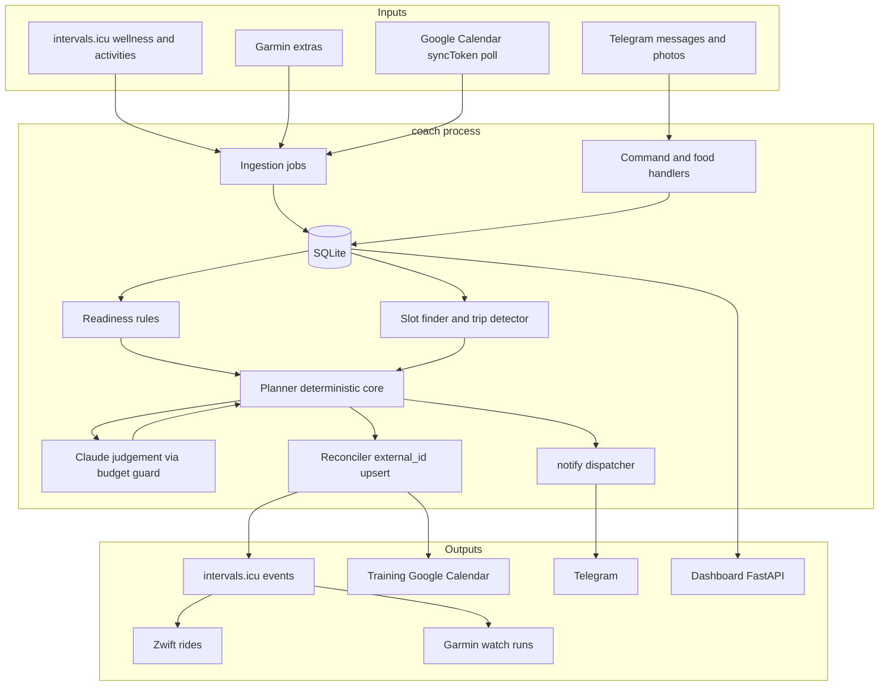

# Personal Cycling Coach - Plan

## Goal Capsule

Build a single-user, context-aware AI cycling coach for Lapo. It runs on Lapo's Hetzner box, reads recovery (Garmin via intervals.icu), calendar and travel (Google Workspace, ethon.io), and training load (intervals.icu). Every day it decides what to train, when and how hard. It writes rides to intervals.icu so they reach Zwift, and runs so they reach the Garmin watch. It tells Lapo what it decided over Telegram, and shows progress on a web dashboard.

The first goal is the Strade Bianche Gran Fondo short route on Sunday 7 March 2027: 87 km, 1,350 m, under 3h30. The supporting goal is 82 → 74 kg. The coach is goal-agnostic and lifelong.

Done means: for two consecutive weeks of real use, every planned session reached Zwift or Garmin without manual intervention. Calendar conflicts and bad nights were handled by the coach. Proactive messages stayed within budget. Claude spend stayed under the cap.

---

## Product Contract

### Summary

The coach owns the plan and acts autonomously: it decides, writes the change, then informs. It asks only when an option would make Lapo get up earlier than his normal routine (the A/B case). Lapo's own edits in intervals.icu always win; the coach replans around them. Food coaching is light: one photo plus one line, one daily check-in, and a weight trend. Integration reliability comes first. The build order proves the delivery spine (intervals.icu → Zwift and Garmin) before any intelligence is layered on top.

### Requirements

**Delivery spine**
- R1. Coach-created workouts are written to intervals.icu idempotently, keyed on a stable `external_id`. Re-running a sync never duplicates events.
- R2. Ride workouts use power as %FTP and appear in Zwift. Verified end to end; `.zwo` export is the fallback.
- R3. Run workouts use pace or HR targets and appear in the Garmin Connect calendar and on the watch through intervals.icu's Garmin upload. Verified end to end; direct upload via `python-garminconnect` is the fallback.
- R4. Gym sessions are written as time blocks (type WeightTraining) with no programme content. Lapo follows the Ladder app; the gym is for posture and shoulder rehab, so it is treated as low-fatigue: it may share a day with an easy ride, never blocks next-day intensity, and is never dropped to make room for riding. Completion is one tap in Telegram (no Ladder integration).

**Recovery and load**
- R5. Daily wellness is ingested from intervals.icu (sleep, HRV, resting HR, weight, CTL/ATL), with Garmin extras (body battery, stress, sleep stages) where available.
- R6. A daily readiness assessment adjusts the day's session: keep it, shorten it, make it easier, swap it, or rest. It then rebalances the week.
- R7. Stale or missing inputs degrade gracefully. The coach falls back to conservative rules and says which input was missing.

**Calendar and travel**
- R8. Calendar events are read via a service account with domain-wide delegation, impersonating Lapo's ethon.io account, polling with `syncToken`.
- R9. Free slots are computed from busy time, quiet hours, the morning routine (07:00–07:30), and travel buffers.
- R10. The travel time from home to a calendar event's location (geocoded) is computed via the Routes API, falling back to a default buffer.
- R11. Trips are detected from the calendar (flights, multi-day events away from home, hotel stays). No-bike days become runs, rest or gym, and riding is front- or back-loaded.
- R12. Coach sessions are mirrored to a coach-owned "Training" Google Calendar.

**Planning**
- R13. A season plan runs from today to the goal date (base → build → peak → taper), grounded in intervals.icu FTP and CTL rather than invented numbers.
- R14. The weekly structure is: 2 weekday Zwift sessions (~45 min), a protected weekend long ride, 2 upper-body gym blocks, and extra sessions when calendar and recovery allow.
- R15. Bike volume is front-loaded in Nov–Dec. Running substitutes for aerobic load during the Jan–Feb travel blocks.
- R16. The coach reports plainly when the goals look infeasible on the current trajectory: the finish time from CTL and the FTP trend, and the weight trend against 0.5–0.7 kg/week.
- R17. Goals are data. New events can be added after Strade Bianche without code changes.

**Messaging and behaviour**
- R18. A Telegram bot, locked to Lapo's chat ID, sends the evening plan, an optional morning adjustment, and a food nudge only when nothing has been logged.
- R19. There are at most 3 proactive messages on a normal day. Quiet hours apply. One message per change, not per thought.
- R20. A/B questions are asked only in the earlier-wake-up case. They have a reply deadline and a default outcome (move the session).
- R21. Free-text commands are supported: "sick", "skip today", "I'm travelling X–Y", "undo", "why?", and a weight entry.
- R22. Every coach action is written to an audit log, and the last change can be undone.

**Food and weight**
- R23. Meal logging takes one photo plus optional text. Claude Haiku vision returns a rough estimate (meal type, rough kcal band, protein, healthy flag) and stores it on the Hetzner box only.
- R24. A daily evening check-in covers eating and hydration (one-tap reply).
- R25. The weight trend is a 7-day average against the target. Fuelling guidance is tied to the training day: more on hard days, a deficit on easy and rest days, full fuelling in the last 2 weeks before the goal.

**Budget**
- R26. Claude spend is tracked per call from `usage` fields into a ledger. An alert fires at 80% of $100/month and a hard stop at 100%. A dedicated Console workspace adds a server-side monthly limit.
- R27. Model tiering: Haiku 5.5 for routine parsing, nudges and vision; Sonnet 5.5 for weekly plans and complex reschedules. A deterministic rules-only planner takes over when the budget is exhausted or the API fails.

**Dashboard**
- R28. A single-user web dashboard, reachable only over Lapo's Tailscale tailnet, shows:
  - A goal header with A/B/C targets.
  - The course profile with gravel sectors and fuelling markers.
  - Fitness/fatigue trend (CTL/ATL/TSB) and power progress.
  - Weight against target, weekly volume bars, plan adherence, daily session cards, and past rides with segment comparisons.
- R29. The visual design is produced with the `impeccable` skill. This plan covers the data/API layer and the page shell only.

**Operations and privacy**
- R30. Data sent to Claude is minimised per call: calendar events go to Claude as `{start, end, title, attendee_count, kind, travel_minutes}` so the coach can judge day load (a run of easy calls vs a heavy day of meetings); descriptions, attendee emails and raw locations are never sent, and no meal photos beyond the vision call. Secrets live in an env file outside the repo.
- R31. Nightly SQLite and photo backups stay on the Hetzner machine, on a separate volume. Health checks alert via Telegram when a poller has failed for longer than its threshold.

---

## Planning Contract

### Key Technical Decisions

- **KTD1. Python 3.12 + FastAPI + SQLite (WAL) + one asyncio process.** FastAPI serves the dashboard and API. python-telegram-bot ≥21 runs long polling in the same loop, embedded in the FastAPI lifespan (`initialize` → `start` → `updater.start_polling`, reversed on shutdown); never `run_polling`, which owns the loop. APScheduler (AsyncIOScheduler) runs the jobs. One process, one user, and simple backups. Deployed with Docker Compose on Hetzner, with no public ports: the dashboard is bound to the Tailscale interface (TLS via `tailscale serve`), and Telegram uses outbound long polling, so nothing needs public ingress.
- **KTD2. intervals.icu is the source of truth for planned and completed workouts; SQLite is the source of truth for coach intent.** Each coach event has a stable `external_id` of the form `coach:{date}:{slot}`; `plan_version` is a column, not part of the id, so re-plans update in place instead of delete-and-recreate. Each row stores a `last_written_hash` of the fields the coach sent. Reconciliation compares intervals.icu events with the `planned_session` rows: a hash mismatch on coach-owned fields is a user edit (adopted and the plan rebuilt around it); a matching hash is the coach's own write and is ignored. An event missing for 2 consecutive polls counts as a user deletion; events the coach deletes itself are tombstoned (`deleted_by_coach`) so they are never adopted. Upsert uses `POST /events/bulk?upsert=true`.
- **KTD3. Delivery verified, not assumed.** U3 is a hard gate before any planning logic: a ride reaches Zwift and a run reaches the Garmin watch. Fallbacks are designed but built only if the gate fails.
- **KTD4. Planner = deterministic core + LLM judgement.** Periodisation maths, TSS targets, the slot finder, readiness rules and the message budget are deterministic Python and unit-tested. Claude chooses between valid candidates, writes the workout rationale and the message text, and handles free text. The rules-only path is always runnable, which makes it both the budget fallback and the test oracle.
- **KTD5. Structured output via `client.messages.parse()` with Pydantic.** No temperature/top_p, no forced tool_choice, no disabled thinking on Sonnet 5.5. A stable system prompt plus athlete profile form a cached prefix of at least 512 tokens.
- **KTD6. Google auth via a service account with domain-wide delegation** (`subject=l@ethon.io`, full `calendar` scope: read all calendars for day load and travel, write the coach's Training calendar). Polling uses `syncToken` every 10 minutes. No push channels.
- **KTD7. Wellness: intervals.icu first, Garmin second.** The Garmin Personal API is used if its scopes include body battery and stress (checked in U5); otherwise `python-garminconnect` 0.3.x with a persisted token file. Never `garth`.
- **KTD8. Time: store UTC, schedule in `Europe/Rome`.** Travel days use the calendar event's timezone for the session-time display.
- **KTD9. Message dispatcher is a single choke point.** Every proactive message goes through `notify()`, which enforces the daily budget, quiet hours, priority and coalescing. A/B prompts carry a TTL (at the latest 21:30, so the default applies before quiet hours) and a default action executed by the scheduler. Health and ops alerts are exempt from the daily cap and quiet hours but limited to once per incident.

### High-Level Design

### Behaviour Rules

- **Ask vs decide.**
  - Decide and inform by default.
  - Ask only when the best option needs Lapo up earlier than 06:45 (aligned with R20).
  - The A/B prompt expires at 22:00 the evening before, or 2 hours after it is sent, whichever comes first. The default outcome is "move the session".
- **Message budget.**
  - At most 3 proactive messages a day.
  - Priority order: safety and sick mode > A/B question > evening plan > morning adjustment > food nudge > progress note.
  - Lower-priority messages are dropped or folded into the next evening plan.
  - Quiet hours are 22:00–06:30. Replies to Lapo's own messages don't count toward the budget.
- **Ownership.**
  - The coach only edits events with an `external_id` starting `coach:`.
  - A user edit to a coach event (time, duration, deletion) is adopted. The session is marked `user_locked`: the coach never moves its date or time, and the lock expires after the session date. A sick day or detected trip may still override a locked session, always with a Telegram notice, an audit row and `/undo`.
- **Sync lag.**
  - A planned session is matched to a completed activity within ±6 hours on the same day and the same sport type.
  - A session counts as missed only after a 12-hour window from its planned end.
- **Readiness.**
  - Each signal is compared with Lapo's own 28-day baseline:
    - HRV below baseline minus 1 SD.
    - Resting HR above baseline plus 5 bpm.
    - Sleep under 5.5 h.
    - Body battery under 30 at wake.
  - Two or more red flags means easier or shorter; three or more means rest.
  - Missing data means using the remaining signals and saying so.
- **Sick mode.**
  - Triggered by the "sick" command.
  - No intensity until Lapo says he is better, or after 3 days with a check-in.
  - Then a 2-day ramp back.
- **Trip correction.** A detected trip is announced once in the evening plan. "Not a trip" on Telegram reverts it.
- **Weight.**
  - Use a 7-day average.
  - Target band 0.5–0.7 kg/week (R16). Warn when the loss rate is above 0.7 kg/week, or below 0.5 kg/week for 3 weeks.
  - No deficit advice on hard days or in the final 14 days before the goal.
- **Budget fallback.**
  - At 80% of the monthly budget, send a Telegram alert and route Sonnet calls to Haiku.
  - At 100%, the rules-only planner runs, templated messages are sent, and food vision is disabled with a polite notice.

### Assumptions

- The intervals.icu → Zwift sync works for API-created workouts with power targets. It may need an "Indoor" tag or flag. Verified in U3.
- The intervals.icu "upload planned workouts to Garmin" setting pushes API-created run workouts. Verified in U3.
- The intervals.icu wellness field names (`sleepSecs`, `sleepScore`, `hrv`, `restingHR`, `weight`, `ctl`, `atl`) are confirmed against a real response in U5.
- Lapo's calendar events carry locations good enough to geocode most of the time. When they don't, a default 45-minute buffer is used.
- The Hetzner box already runs Docker. A domain or subdomain is available for the dashboard with TLS.

### Open Questions

- **Deferred:**
  - Exact Garmin Personal API scopes. Resolved in U5 by checking Swagger, and does not block U1–U4.
  - Whether the Zwift sync needs an indoor tag. Resolved in U3 by experiment.
  - Dashboard visual design. Owned by `impeccable` after U12.
  - iMessage relay. Out of scope.
- **Blocking:** none.

### Sequencing

1. **Milestone A (spine):** U1 → U2 → U3. Gate: a ride is in Zwift and a run is on the watch.
2. **Milestone B (daily loop):** U4 and U6 in parallel after U1; U5 after U2; U7 after U6; then U8. Ship a rules-only season plan to intervals.icu as soon as U8 lands, so the Nov–Dec base window isn't lost.
3. **Milestone C (conversation + scheduling):** U9, then U10. Behaviour rules go live with the scheduler.
4. **Milestone D (food):** U11.
5. **Milestone E (dashboard):** U12 for the backend and shell, then the `impeccable` design pass, then U13 ops hardening. U13's backups start in Milestone A; its Telegram health alerts follow U9.

---

## Implementation Units

### Unit Index

| ID | Name | Depends on | Milestone |
|---|---|---|---|
| U1 | Scaffold, config, schema, audit log, deploy | none | A |
| U2 | intervals.icu client and workout builder | U1 | A |
| U3 | Delivery verification gate (Zwift + Garmin) | U2 | A |
| U4 | Claude client with budget ledger | U1 | B |
| U5 | Wellness ingestion and readiness | U1, U2 | B |
| U6 | Google Calendar sync, slots, trips, Training calendar | U1 | B |
| U7 | Travel time | U6 | B |
| U8 | Planner and reconciler | U2, U3, U4, U5, U6, U7 | B |
| U9 | Telegram bot, dispatcher, commands | U1, U4, U8 | C |
| U10 | Scheduler jobs | U5, U6, U8, U9 | C |
| U11 | Food and weight | U4, U9 | D |
| U12 | Dashboard backend and shell | U5, U8, U11 | E |
| U13 | Ops: backups, health, privacy | U1, U9 | A/E |

### U1. Scaffold, config, schema, audit log, deploy

- **Goal:** Create a runnable empty service on Hetzner with config, DB migrations and an audit log.
- **Requirements:** R22, R30, KTD1, KTD8.
- **Files:**
  - `pyproject.toml`
  - `coach/__init__.py`
  - `coach/main.py`
  - `coach/config.py`
  - `coach/db/schema.sql`
  - `coach/db/migrate.py`
  - `coach/db/repo.py`
  - `coach/audit.py`
  - `Dockerfile`
  - `docker-compose.yml`
  - `deploy/tailscale-serve.json`
  - `.env.example`
  - `tests/test_config.py`
  - `tests/test_audit.py`
- **Approach:**
  - Use pydantic-settings for config.
  - Run SQLite in WAL mode, with numbered SQL migrations applied at startup.
  - Tables:
    - `athlete`
    - `goal`
    - `season_plan`
    - `planned_session`, with `external_id`, `plan_version`, `last_written_hash`, `gcal_event_id`, `status`, `user_locked` and `deleted_by_coach`.
    - `activity`
    - `wellness_day`
    - `calendar_event`
    - `trip`
    - `message_log`
    - `pending_choice`
    - `meal`
    - `weight`
    - `llm_call`
    - `audit`
    - `sync_state`
  - Each audit row stores an action, a before/after JSON payload, and a reason.
  - `main.py` starts FastAPI, the scheduler and the Telegram bot in one loop. The app exposes `/healthz`.
- **Test scenarios:**
  - Config fails fast on a missing secret.
  - Migrations are idempotent across two runs.
  - Audit writes and reads back the before/after payload.
  - Timestamps are stored in UTC and rendered in Europe/Rome.
- **Verification:** `docker compose up -d` on Hetzner makes `/healthz` return 200 over TLS.

### U2. intervals.icu client and workout builder

- **Goal:** Provide a typed client plus a builder that turns a structured session into intervals.icu workout text.
- **Requirements:** R1, R2, R3, R4, KTD2.
- **Files:**
  - `coach/integrations/intervals.py`
  - `coach/workouts/model.py`
  - `coach/workouts/builder.py`
  - `tests/test_intervals_client.py`
  - `tests/test_workout_builder.py`
  - `tests/fixtures/intervals/`
- **Approach:**
  - Use httpx with Basic auth (`API_KEY`, key) and a browser-like User-Agent, with retry and backoff on 429/5xx.
  - Methods:
    - `get_athlete` (FTP from `sportSettings`)
    - `list_events`
    - `upsert_events`
    - `delete_events` (bulk-delete)
    - `get_wellness`
    - `list_activities`
    - `download_zwo`
  - Pydantic `Session` model fields:
    - sport
    - start
    - steps (duration, target type power%/pace/HR zone, cadence)
    - name
    - rationale
  - The builder emits text such as `- 10m 55-65%` and `Main set 4x` with nested steps.
  - Rides use power %FTP only. Runs use pace or HR zones. Gym uses an empty description and a duration.
- **Test scenarios:**
  - The builder output for ride, run and gym matches golden text.
  - Ramps and repeats render correctly.
  - The upsert payload carries `external_id` and the correct `type`.
  - Round trip: write a plan, poll it back, reconcile → zero adoptions (intervals.icu's saved form doesn't trip the hash).
  - Live-API check (once, recorded as a fixture): upsert, date move and delete behave as assumed.
  - A 429 triggers a retry.
  - Upserting the same session twice produces one event (against a recorded fixture).
- **Verification:** A script creates, updates and deletes a test workout on Lapo's intervals.icu calendar and leaves no duplicates.

### U3. Delivery verification gate (Zwift + Garmin)

- **Goal:** Prove that the coach's workouts reach Zwift and the Garmin watch, and build fallbacks only if needed.
- **Requirements:** R2, R3, KTD3.
- **Files:**
  - `scripts/verify_delivery.py`
  - `coach/integrations/garmin_upload.py` (fallback only)
  - `coach/integrations/zwo.py` (fallback only)
  - `docs/runbooks/delivery-verification.md`
- **Approach:**
  - Write tomorrow's ride (power %FTP) and run (pace/HR) via U2.
  - Lapo checks the Zwift workout list and the Garmin Connect calendar and watch. The result is recorded in the runbook.
  - If Zwift fails, try the indoor tag or flag and then the `.zwo` download into Zwift's workouts folder.
  - If Garmin fails, add the `python-garminconnect` workout upload path behind a feature flag.
- **Test scenarios:**
  - The fallback adapters are unit-tested against fixtures only if they are built.
  - The verification script is idempotent.
- **Verification:**
  - Gate passed: Lapo confirms the ride is visible in Zwift and the run is on the watch.
  - The outcome is recorded in `docs/runbooks/delivery-verification.md`.
  - No planning work starts before this gate.

### U4. Claude client with budget ledger

- **Goal:** Provide one wrapper for all Claude calls, with tiering, structured output, cost tracking and hard caps.
- **Requirements:** R26, R27, KTD5.
- **Files:**
  - `coach/llm/client.py`
  - `coach/llm/budget.py`
  - `coach/llm/prompts/`
  - `tests/test_budget.py`
  - `tests/test_llm_client.py`
- **Approach:**
  - `call(task, schema, tier)` picks the model, attaches the cached system prefix, and uses `messages.parse`.
  - Cost is computed from `input_tokens`, `output_tokens`, `cache_creation_input_tokens` and `cache_read_input_tokens` with a price table in config. Each call writes an `llm_call` row.
  - The guard checks month-to-date spend before each call:
    - At 80%, alert once and downgrade the tier.
    - At 100%, raise `BudgetExhausted`.
  - Callers catch `BudgetExhausted` and use the rules path.
  - Prompts stay under 100K tokens to avoid Haiku's long-context price.
- **Test scenarios:**
  - The cost maths matches hand-computed values, including cache reads.
  - The 80% threshold alerts exactly once a month.
  - At 100% the call is refused before any network request.
  - The month rollover resets spend.
  - A parse failure retries once and then falls back.
  - No temperature parameter is ever sent.
- **Verification:** A real Haiku call writes a ledger row whose cost matches the Console usage within rounding.

### U5. Wellness ingestion and readiness

- **Goal:** Build daily wellness and activity sync, and a deterministic readiness score.
- **Requirements:** R5, R6, R7, KTD7.
- **Files:**
  - `coach/ingest/wellness.py`
  - `coach/ingest/activities.py`
  - `coach/integrations/garmin.py`
  - `coach/readiness.py`
  - `tests/test_readiness.py`
  - `tests/test_wellness_ingest.py`
- **Approach:**
  - Poll intervals.icu wellness and activities every 30 minutes from 05:30–10:00, then hourly.
  - Check the Garmin Personal API Swagger for body battery and stress scopes. Use `python-garminconnect` if they are missing, with the token file in a volume.
  - Readiness compares against 28-day personal baselines, per the Behaviour Rules. Output: `green`, `amber`, `red` or `unknown`, plus reasons and missing inputs.
  - The freshness rule: poll every 10 minutes from 06:30; readiness runs as soon as today's sleep arrives, with a hard deadline at 07:45 after which it uses the remaining signals and flags it. Baselines need at least 14 days of valid data, otherwise `unknown`.
- **Test scenarios:**
  - Baselines are computed with fewer than 28 days of data.
  - Each red flag fires independently.
  - Two flags give amber; three or more give red.
  - All missing inputs give `unknown`, and the coach plans conservatively.
  - Late-arriving data re-scores the day without duplicate messages.
  - Field mapping is checked against a real recorded wellness fixture.
- **Verification:** Seven days of real data are ingested and the readiness history is plausible against Lapo's recollection of those nights.

### U6. Google Calendar sync, slots, trips, Training calendar

- **Goal:** Read Lapo's busy time, find free training slots, detect trips, and mirror sessions to a Training calendar.
- **Requirements:** R8, R9, R11, R12, KTD6.
- **Files:**
  - `coach/integrations/gcal.py`
  - `coach/calendar/slots.py`
  - `coach/calendar/trips.py`
  - `tests/test_slots.py`
  - `tests/test_trips.py`
  - `tests/test_gcal_sync.py`
  - `docs/runbooks/google-dwd-setup.md`
- **Approach:**
  - Set up a service account with domain-wide delegation in the ethon.io admin console (runbook).
  - Run an incremental `events.list` with `syncToken` every 10 minutes, doing a full resync on 410.
  - Create the "Training" calendar once and store its id.
  - The slot finder works from busy intervals, quiet hours, preferred windows (07:00–07:30 weekdays, weekend morning long ride), a pre/post buffer, and travel time from U7.
  - Trip detection uses:
    - flight keywords or airline senders
    - all-day events with locations outside the home region
    - hotel or lodging keywords
    - timezone changes
  - Mirrored events carry a coach marker and are never read back as busy.
- **Test scenarios:**
  - Overlapping meetings merge into one busy block.
  - The 08:30 train case gives a latest finish time for the morning slot.
  - All-day non-trip events (holidays) don't block the morning.
  - A multi-day out-of-town event becomes a trip.
  - "Not a trip" overrides detection.
  - An expired sync token triggers a full resync.
  - Training calendar events are excluded from busy time.
- **Verification:** Next week's computed slots match Lapo's real calendar when checked by eye.

### U7. Travel time

- **Goal:** Estimate home-to-event travel time for buffer calculations.
- **Requirements:** R10.
- **Files:**
  - `coach/integrations/maps.py`
  - `tests/test_maps.py`
- **Approach:**
  - Geocode the free-text location (cached per string).
  - Call the Routes API `computeRouteMatrix` from the configured home address, and cache results per (origin, destination, hour bucket).
  - Mode: transit for stations and airports, driving otherwise. Traffic-aware only for the next-morning case.
  - Fall back to a 45-minute buffer.
- **Test scenarios:**
  - A geocoding failure falls back to the default buffer.
  - A repeated query is served from cache.
  - Stations are classified as transit.
- **Verification:** The duration for "Firenze Santa Maria Novella" from home is within 10 minutes of Google Maps.

### U8. Planner and reconciler

- **Goal:** Plan the season, the week and the day, apply recovery and calendar context, and sync to intervals.icu and the Training calendar.
- **Requirements:** R6, R11, R13, R14, R15, R16, R17, R20, R22, KTD2, KTD4.
- **Files:**
  - `coach/plan/season.py`
  - `coach/plan/week.py`
  - `coach/plan/day.py`
  - `coach/plan/library.py`
  - `coach/plan/feasibility.py`
  - `coach/plan/reconcile.py`
  - `tests/test_season.py`
  - `tests/test_week.py`
  - `tests/test_day.py`
  - `tests/test_reconcile.py`
  - `tests/test_feasibility.py`
- **Approach:**
  - **Season.** Phases are back-calculated from the goal date (taper 10–14 days, peak 2–3 weeks, build, base). Weekly TSS targets come from the current CTL with a capped ramp (≤5–7 CTL/week). Bike volume is front-loaded Nov–Dec, and Jan–Feb trip weeks get run substitution with run TSS discounted.
  - **Week.** A template of 2 weekday rides, a weekend long ride, 2 gym blocks, plus optional extras. Sessions are placed into slots from U6.
  - **Library.** Parametric workouts (Z2, sweet spot, threshold, VO2, gravel-specific surges, long ride with race-pace blocks, run easy or tempo).
  - **Day.** Applies readiness: keep, shorten, make easier, swap or rest, then rebalances the remaining week.
  - **Claude.** Sonnet weekly and Haiku daily. Claude picks among deterministic candidates and writes rationales. With the budget exhausted, the top-ranked candidate is used.
  - **Reconciler.** Diffs desired against intervals.icu state, upserts and deletes by `external_id`, detects user edits (adopt and lock), mirrors to the Training calendar, and writes audit rows.
  - **Feasibility.** Estimates finish time from FTP, kg and CTL (sustainable fraction of FTP over ~3h) against the course profile (power-speed model on the GPX gradient, plus a gravel penalty; CdA/Crr are defaults until calibrated from Lapo's outdoor rides), alongside the weight trend. Flags when a goal is off-track.
- **Test scenarios:**
  - Season phases land correctly for 7 March 2027 from 3 November 2026.
  - The CTL ramp never exceeds the cap.
  - A red-readiness day turns intervals into Z2 or rest and moves load to the next green slot.
  - A trip week has no rides and has runs.
  - The 08:30-train case produces an A/B with a correct latest-start time.
  - A user deleting a coach workout means it is adopted and not recreated.
  - A user moving one means it is locked.
  - The reconciler is idempotent across runs.
  - The rules-only path produces a valid week with no LLM.
  - The feasibility estimate at 82 kg and the current FTP gives a time that changes monotonically with FTP and weight.
  - The long ride is never dropped while a weekday alternative exists.
- **Verification:** Generate the real plan to race day. Lapo reviews week 1 and the season shape. A dry-run diff shows exactly what will be written before the first live sync.

### U9. Telegram bot, dispatcher, commands

- **Goal:** Provide the conversation surface, with strict message discipline.
- **Requirements:** R18, R19, R20, R21, R22, KTD9.
- **Files:**
  - `coach/bot/app.py`
  - `coach/bot/notify.py`
  - `coach/bot/commands.py`
  - `coach/bot/choices.py`
  - `tests/test_notify.py`
  - `tests/test_commands.py`
  - `tests/test_choices.py`
- **Approach:**
  - python-telegram-bot long polling with a `filters.Chat(chat_id=LAPO)` lock.
  - `notify(kind, text, priority)` enforces the budget, quiet hours and coalescing, and logs to `message_log`.
  - A/B uses an inline keyboard with `callback_data` set to a `pending_choice` id (≤64 bytes). A scheduler job executes the default on TTL.
  - Free text: regex fast paths first (weight, undo, sick, skip), then a Haiku intent parse constrained to a closed enum (sick, injury, skip, travel, not_trip, undo, why, weight, meal-text, other); anything outside the enum maps to `other`.
  - "why?" returns the last decision's audit reason. "undo" reverts the last audit action through the reconciler.
- **Test scenarios:**
  - A 4th proactive message is dropped or folded.
  - A message at 23:00 is deferred.
  - Priority ordering holds.
  - An A/B reply before TTL applies the choice; no reply applies the default; a reply after TTL gets a polite "already moved".
  - Messages from other chats are ignored.
  - "82.4" logs weight.
  - "sick" enters sick mode and clears intensity for 3 days.
  - Undo restores the previous session state.
- **Verification:** One real day: evening plan received, morning adjustment only when needed, total of 3 or fewer.

### U10. Scheduler jobs

- **Goal:** Wire the daily rhythm.
- **Requirements:** R6, R18, R19, R24, R31.
- **Files:**
  - `coach/jobs.py`
  - `tests/test_jobs.py`
- **Approach:** APScheduler jobs, all in Europe/Rome:
  - Ingest wellness and activities (U5 cadence).
  - Calendar poll every 10 minutes.
  - Morning readiness on data arrival (06:30–07:45 window, per U5), re-planning today if needed.
  - Evening plan at 20:30, covering tomorrow plus the A/B case.
  - Food check-in at 21:00, only if nothing was logged.
  - Weekly plan on Sunday at 18:00.
  - Choice TTL sweeper.
  - Health check.
  - Jobs are idempotent per day via `sync_state` and are coalesced so missed runs don't stack.
- **Test scenarios:**
  - A job re-run on the same day does not resend.
  - A missed run after a restart executes once.
  - Startup catch-up: on boot, any job whose daily slot passed without a `sync_state` success runs once (APScheduler `misfire_grace_time` + `coalesce=True`).
  - A DST transition keeps local times.
- **Verification:** One week of jobs runs on Hetzner with no duplicates in `message_log`.

### U11. Food and weight

- **Goal:** Provide light meal logging and weight-goal support.
- **Requirements:** R23, R24, R25.
- **Files:**
  - `coach/food/vision.py`
  - `coach/food/handlers.py`
  - `coach/food/weight.py`
  - `tests/test_weight.py`
  - `tests/test_food_handlers.py`
- **Approach:**
  - Download the photo (`photo[-1]`), downscale it to ~1100 px, store it under `/data/meals/`, and run a Haiku vision call into a Pydantic estimate.
  - Reply in one line with a quick tip that relates to the day's training load.
  - Weight comes from intervals.icu wellness or a Telegram entry, using the 7-day average and warnings per the Behaviour Rules.
  - Fuelling guidance comes from the planned session for today and tomorrow.
- **Test scenarios:**
  - The 7-day average handles gaps.
  - Rate warnings fire at the thresholds.
  - The final 14 days before the goal suppress deficit advice.
  - A photo without a caption still logs.
  - Food vision is disabled when the budget is exhausted.
- **Verification:** One week of real logging with replies at or under 2 lines.

### U12. Dashboard backend and shell

- **Goal:** Provide data endpoints and a Tailscale-only page shell for the `impeccable` design pass.
- **Requirements:** R28, R29, R30.
- **Files:**
  - `coach/web/app.py`
  - `coach/web/auth.py`
  - `coach/web/api.py`
  - `coach/course/gpx.py`
  - `coach/web/templates/`
  - `coach/web/static/`
  - `tests/test_web_api.py`
  - `tests/test_gpx.py`
- **Approach:**
  - No app login: access control is the Tailscale tailnet. The app binds only to the Tailscale interface and refuses requests from other interfaces.
  - JSON endpoints:
    - goal and targets
    - course profile (smoothed elevation from the GPX, gravel sectors and fuelling markers)
    - fitness series
    - power curve
    - weight series
    - weekly volume
    - adherence
    - sessions by day
    - activities with segment comparisons
  - The course profile is smoothed to the official 1,350 m, not the raw 1,740 m.
  - Server-rendered shell. The visual layer comes from `impeccable`.
- **Test scenarios:**
  - Requests not arriving via the Tailscale interface are rejected.
  - GPX smoothing gives total climb within 10% of 1,350 m and 6 gravel sectors located.
  - Endpoints return empty-state shapes with no data.
- **Verification:** The dashboard loads over Tailscale on a phone and all endpoints return real data; the public IP exposes no open ports.

### U13. Ops: backups, health, privacy

- **Goal:** Keep it running and keep the data safe.
- **Requirements:** R30, R31.
- **Files:**
  - `deploy/backup.sh`
  - `coach/health.py`
  - `coach/llm/redact.py`
  - `tests/test_redact.py`
  - `tests/test_health.py`
  - `docs/runbooks/ops.md`
- **Approach:**
  - Run a nightly `sqlite3 .backup` plus a meals tarball to a separate volume on the Hetzner machine, kept for 30 days. Optional: enable Hetzner server snapshots as a disk-loss safety net (stays on Hetzner).
  - Health: last-success timestamps per poller, with a Telegram alert when stale for longer than 2× the interval. The alert is exempt from the daily cap and quiet hours (per KTD9) but limited to once per incident.
  - Redaction: calendar events are sent to Claude as `{start, end, title, attendee_count, kind, travel_minutes}`; descriptions, attendee emails and raw locations are stripped. No photos are sent except in the vision call.
- **Test scenarios:**
  - Redaction keeps titles and attendee counts, and strips descriptions, attendee emails and raw locations.
  - A stale poller alerts once.
  - A backup restore round-trips.
- **Verification:** A restore drill from the local backup volume on a scratch container succeeds.

---

## Verification Contract

- **Unit tests:** `pytest` passes, including the deterministic planner, behaviour rules, budget and redaction.
- **Lint and types:** `ruff check` and `mypy coach` are clean.
- **Delivery gate (U3):** a ride is confirmed in Zwift and a run on the Garmin watch, recorded in the runbook.
- **Dry-run gate (U8):** the first live sync shows a diff of the intervals.icu events to be written and is approved by Lapo once.
- **Real-data checks:**
  - Ledger cost matches Console usage.
  - Readiness against 7 real days.
  - Slots against the real calendar.
  - `message_log` shows 3 or fewer proactive messages a day for a week.
- **Production:** `/healthz` returns 200 over Tailscale, the backup restore drill passes, and no secrets are in the repo.

---

## Definition of Done

- All 13 units are implemented and verified per their Verification lines.
- Two consecutive weeks of real use with:
  - Every coach session delivered to Zwift or Garmin with no manual step.
  - Every bad-night and calendar conflict handled by the coach and explained.
  - At most 3 proactive messages a day.
  - Claude spend tracked against the $100/month cap, with no 80% alert fired during the period.
- The dashboard is live behind Tailscale with the `impeccable` design applied.
- The season plan to 7 March 2027 exists, with a feasibility statement for sub-3h30 and 74 kg.

---

## Appendix

- **Cost estimate:**
  - About 60 Haiku calls a day at roughly 3K in and 400 out.
  - About 1 Sonnet weekly plan at roughly 20K in and 4K out.
  - About 3 vision calls a day.
  - Total about $2–5 a month. The $100 cap is a runaway backstop.
- **Feasibility note:**
  - 82 → 74 kg in about 18 weeks is about 0.44 kg/week, just below the 0.5–0.7 kg/week target band, so feasible but tight around the Jan–Feb travel.
  - The coach should report the projected race-day weight, not promise 74 kg.
- **External references:**
  - intervals.icu API docs (`https://intervals.icu/api/v1/docs`)
  - Google Calendar API (domain-wide delegation)
  - Routes API `computeRouteMatrix`
  - python-telegram-bot v21
  - Anthropic Messages API structured output
