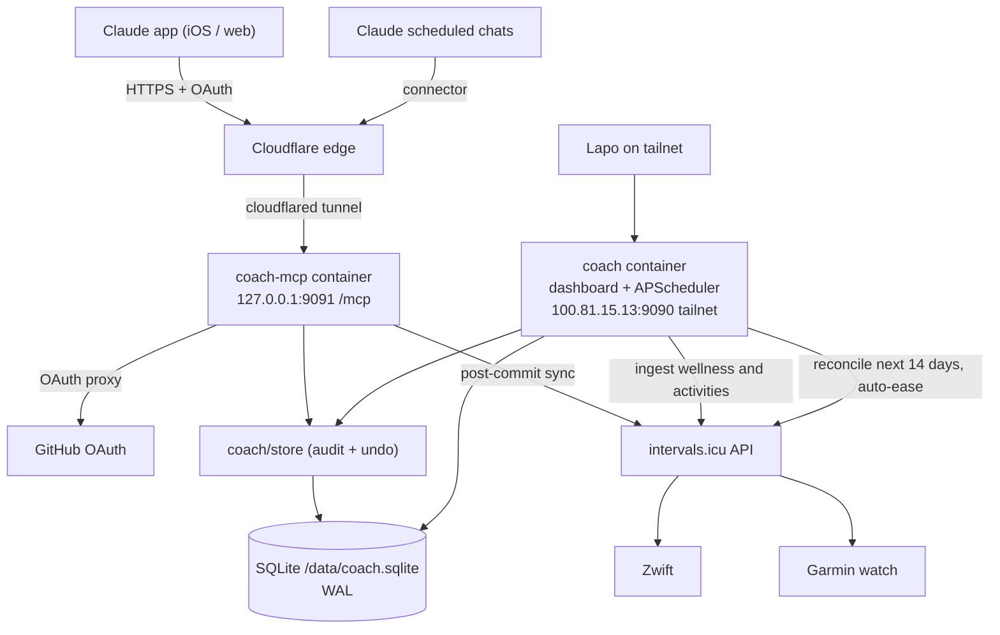

# Claude App Coach over Remote MCP - Plan

## Goal Capsule

**Objective.** Make the Claude app on Lapo's phone the only chat interface to the coach. Claude connects to a public, login-protected remote MCP server on catone. That server reads and writes the coach SQLite DB, and it also moves workouts in intervals.icu. The server keeps running the autonomous jobs: the daily workout push, the bad-night auto-ease before 07:00, and ingestion. The Tailscale-only dashboard shows what the server and Claude did and why.

**Authority hierarchy.**
1. Lapo's instructions in chat.
2. This plan.
3. `docs/plans/2026-11-03-001-feat-personal-cycling-coach-plan.md`, for anything this plan does not override. Its behaviour rules, KTD2 (intervals.icu sync semantics) and KTD8 (UTC storage, Europe/Rome scheduling) stay in force.
4. `PRODUCT.md` and `DESIGN.md`.

**Stop conditions.** Stop and ask Lapo in four cases:
- The OAuth spike in U8 cannot complete a Claude connector login with the chosen identity provider.
- A change would edit migrations 001–003.
- A change would touch `/opt/coach/app` or `/opt/coach/.env` outside the U12 deploy step.
- A change needs `sudo` on catone, which is Lapo's to run.

**Execution profile.** Work in `catone:~/coach-dev`. The folder is not a git repo. Prod builds from `/opt/coach/app` and is not touched until U12. Use test-first for the store layer, the readiness scoring, the reconciler and the auth checks.

**Tail ownership.** The implementer owns U1–U12 through a passing test suite and a deployed stack. Lapo owns three U13 steps: adding the connector on claude.ai, setting tool permissions, and creating the scheduled chats. The implementer writes the guide for those steps and runs the live verification with Lapo.

---

## Product Contract

### Summary

The coach becomes personal software. The DB and the jobs live on catone, and Claude is the brain and the voice. There is no Telegram bot and no in-app Claude API spend. Every judgement in conversation (food estimates from photos, scale readings, monthly plan design, the weekly review prose) happens in Lapo's own Claude chat. Claude then calls typed tools to store the result. The server stays deterministic. It ingests data, scores readiness, eases sessions on bad nights, and keeps intervals.icu in sync. Zwift and Garmin delivery keeps working through intervals.icu, unchanged.

### Problem Frame

The 2026-11-03 plan put chat in Telegram, with a server-side Claude client. Lapo wants to talk to the coach from the Claude app he already uses, with photos, and to have that conversation write back into his data. The dashboard and the intervals.icu delivery spine are already built and verified (U3). The missing pieces are a public, authenticated MCP surface, a write layer, wellness ingestion and the autonomous jobs.

### Requirements

**Chat surface**
- R1. The Claude app on iOS and claude.ai web reach the coach through one custom remote MCP connector, using the Streamable HTTP transport.
- R2. Only Lapo's identity can complete the connector login. Every other identity is refused at the authorisation step. Tokens survive server restarts.
- R3. The MCP endpoint (`/mcp`) and the OAuth endpoints it needs (discovery metadata, authorize, token, register, callback) are the only public surface. The dashboard stays Tailscale-only, and no other port is exposed.

**Read**
- R4. Claude can read sleep, HRV, resting HR, body battery and today's readiness, including the reasons behind the score.
- R5. Claude can read completed activities and planned sessions for any date range, including the reason for any auto-ease.
- R6. Claude can read fitness: CTL, ATL, form, power bests and the weight trend.
- R7. Claude can read long-term trends: weekly aggregates over months for weight, CTL, sleep, HRV and resting HR.
- R8. Claude can read the current monthly plan, notes, the supplement schedule with today's intake, recent meals and past weekly reviews.

**Write**
- R9. Claude logs meals with a description, estimated kcal and macros, and its confidence. Claude reads the photo; the server stores only the values Claude extracted.
- R10. Claude logs weight (for example, read from a scale photo). Readings marked implausible are flagged, not silently stored.
- R11. Claude saves free-text notes, with optional tags and an optional date.
- R12. Claude logs supplement intake against a supplement schedule that Claude can also edit.
- R13. Claude can move, skip or swap a planned session ("meeting tomorrow, push it to Wednesday"). intervals.icu reflects the change within one tool call, and every change can be undone.
- R14. A monthly plan built in chat is saved as structured sessions, validated, and pushed to intervals.icu.
- R15. Claude saves a weekly review in prose, and it appears on the dashboard.

**Autonomy**
- R16. The server keeps intervals.icu in sync with the plan for the next 14 days without manual action. Rides keep reaching Zwift and runs keep reaching Garmin.
- R17. After a bad night, the server downgrades or cancels a hard session for that day before it starts, and before 07:00 Europe/Rome for morning sessions (deadline in KTD9). Sessions that were moved are still eligible; only sessions Lapo explicitly locked are left alone. It records the reason, and the dashboard shows it.
- R18. On Sunday the server computes a numeric weekly summary, so the dashboard has a weekly view even if no Claude review arrives.
- R19. Wellness and activities are ingested from intervals.icu often enough to feed readiness and the read tools.

**Reminders**
- R20. Meal reminders (breakfast, lunch, dinner) and supplement reminders come from Claude scheduled chats. The server has no push channel.

**Data safety**
- R21. Every write the coach makes, whether from Claude or a job, is audited with before and after state. Plan changes are undoable.
- R22. Backups include the coach DB, the OAuth token store and meal data, and they are restorable.

### Scope Boundaries

**In scope.** The MCP server, auth and public exposure; read and write tools; intervals.icu wellness and activity ingestion; the store layer; the plan reconciler; readiness scoring; the scheduler jobs; dashboard additions; deploy and backups; the setup guide for Lapo; removing Telegram and the LLM client.

**Out of scope.**
- Apple Health.
- Any server-side LLM call.
- A server push channel (ntfy, Pushover, email).
- A public dashboard.
- Multiple users.
- Food photo storage. Claude sees the photo; the server keeps only the values.

**Carried from the 2026-11-03 plan unchanged and not re-planned here.**
- U6 Google Calendar sync and U7 travel time. This plan does not depend on them. Once they land, the planner and the read tools consume `calendar_event` and `trip`.
- U3 delivery gate. Already passed.

**Superseded.**
- Old U4 (Claude client and budget).
- Old U9 (Telegram).
- The chat parts of old U11 (food and weight via Telegram).
- Old U10's Telegram messages and evening plan message.

### Success Criteria

For 14 consecutive days of real use, all of the following hold:
- Lapo logs meals and weight from the phone in a single Claude turn each.
- At least one "push it to tomorrow" move lands in intervals.icu and Zwift without touching intervals.icu by hand.
- Every planned ride appears in Zwift.
- Every bad night (2 or more red flags) produces an eased session before its KTD9 deadline (moved sessions included, explicitly locked ones get advice instead), with its reason visible on the dashboard.
- No foreign identity can complete the connector login, verified once with a second account.
- One weekly review is saved by a Claude scheduled chat, or the U13 verification records that unattended writes don't work, and the server summary covers the gap.

### Dependencies

- An intervals.icu API key, with `zwift_upload_workouts` on. Already verified.
- A GitHub account for Lapo and a GitHub OAuth app, which Lapo creates before the U8 spike (callback per FastMCP's requirement on the spike hostname). A second GitHub account for the refusal test.
- The existing cloudflared tunnel on catone, plus a DNS name on a Cloudflare zone Lapo controls (`lapolazzati.com`).
- `sudo` on catone, run by Lapo, to edit `/etc/cloudflared/config.yml`.
- Claude Pro or higher for custom connectors and scheduled tasks.

### Outstanding Questions

None is blocking. Each one below has a verification step in U13 and a fallback that is already planned.

- Q1 (deferred). Can Claude scheduled chats call this custom connector's write tools unattended, with no approval prompt? If not, reminders still work as prompts that Lapo answers by replying, and the R18 server summary replaces the scheduled weekly review.
- Q2 (deferred). Do scheduled chats notify the phone? If not, Lapo relies on habit and the dashboard, and the plan accepts this.
- Q3 (deferred). Does the connector work in the iOS app once it is added on the web? One third-party report says some tools fail on mobile. The fallback is to keep tool schemas flat and simple (KTD6) and to retest. Mobile Safari on claude.ai is the last resort.
- Q4 (deferred). When does last night's Garmin sleep reach intervals.icu? If it regularly arrives after 06:50, auto-ease runs on whatever signals have arrived and says so (KTD9).
- Q5 (deferred). Which hostname? The working default is `coach-mcp.lapolazzati.com`.
- Q6 (deferred). What time does Lapo usually wake and the watch sync? Tunes the 05:45 poll start and the 06:50 cutoff.
- Q7 (deferred). Are hard sessions usually in the morning or the evening? Decides how often the session-start deadline, rather than 06:50, applies (KTD9).
- Q8 (deferred). Canonical slot names and default times. Working default: `am`=07:00, `pm`=18:00 (KTD11); confirm with Lapo before U5 lands.
- Q9 (deferred). Does body battery arrive in intervals.icu wellness, and under which field? Checked against the real payload in U3; if absent, readiness scores on 3 signals and lists body battery as missing.
- Q10 (deferred). Which FastMCP setting caps DCR client registrations and restricts `redirect_uri`? Answered in the U8 spike; if none exists, a thin wrapper on the register endpoint enforces both.
- Q11 (deferred). Does Claude's connector use CIMD with this FastMCP version, making DCR unnecessary? Answered in the U8 spike.
- Q12 (deferred). Should 004 drop the Telegram tables now, or keep them one release for rollback? Default: drop (KTD13), after the U2 prod-copy check shows they hold nothing Lapo wants.

---

## Planning Contract

### Key Technical Decisions

- KTD1. **FastMCP 3 with `OAuthProxy` to GitHub, plus a one-account allowlist.** Claude's connector needs a full OAuth server: discovery, a 401 with `WWW-Authenticate`, PKCE S256, DCR or CIMD, and rotating refresh tokens. Building that by hand is the riskiest part of this work. FastMCP's `OAuthProxy` implements it and hands identity to GitHub. A post-login check compares the GitHub numeric user ID against `COACH_MCP_ALLOWED_GITHUB_ID` and refuses everyone else. The numeric ID is used because logins can be renamed. The check fails closed: a missing `/user` response, a missing `id`, or an id not on the list is a refusal, and each path has a test. DCR is hardened: a registered `redirect_uri` must be exactly `https://claude.ai/api/mcp/auth_callback`, PKCE must be S256, and the number of registered clients is capped (Q10; if FastMCP lacks either setting, a thin wrapper enforces it). Google is the swap-in if GitHub proves awkward, and only the provider class changes. leis-mcp uses the official `mcp` SDK with no auth, so it is a transport precedent only.
- KTD2. **Persist OAuth state on disk under `/data/mcp-auth/`, encrypted with a key from `.env`.** In-memory storage would force a re-login after every deploy. The JWT signing key and the storage encryption key come from `COACH_MCP_JWT_KEY` and `COACH_MCP_STORAGE_KEY`. `COACH_MCP_PUBLIC_URL` holds the origin only (`https://coach-mcp.lapolazzati.com`); the protected-resource `resource` and the token audience are that origin plus `/mcp`, which is exactly what Lapo types into Claude. Access tokens live about 1 hour; refresh tokens rotate and have a bounded lifetime. `.env` is mode 600, and the keys plus `/data/mcp-auth/` are excluded from backups. `deploy/runbook-auth.md` covers key rotation and revoke-all (wipe `/data/mcp-auth/`, rotate both keys, reconnect).
- KTD3. **Expose through the existing cloudflared tunnel, not Tailscale Funnel.** cloudflared already serves `lapolazzati.com` hosts from catone, and Funnel is not enabled. A new ingress rule maps `coach-mcp.lapolazzati.com` to `http://127.0.0.1:9091`. The MCP container binds only `127.0.0.1`, so the tailnet dashboard on `100.81.15.13:9090` never becomes public. Optionally, a Cloudflare WAF rule restricts `/mcp` to Anthropic egress (`160.79.104.0/21`, `153.61.208.0/20`), leaving the OAuth endpoints open for the browser login. A Cloudflare rate-limiting rule caps requests per IP on the whole hostname, with a tighter limit on `/register` and `/token`.
- KTD4. **Separate `coach-mcp` service, same image and same `/data` volume.** One image, two commands: `uvicorn coach.main:app` for the dashboard and jobs, and `coach-mcp` for MCP. The public process has no dashboard routes. SQLite runs in WAL mode with `busy_timeout=5000` on every write connection, so two writer processes are safe at this volume. Only `coach` runs migrations. `coach-mcp` refuses to serve until the schema version is at least 4, and compose starts it with `depends_on: coach: condition: service_healthy`.
- KTD5. **Scheduler runs inside the dashboard process (`coach`), not in `coach-mcp`.** APScheduler 3 is already a dependency. One scheduler means jobs never run twice. The MCP process never runs jobs. A restart of `coach-mcp` (for example, an auth change) doesn't affect the 07:00 ease.
- KTD6. **Tool design: few, flat, typed, annotated.**
  - Reads carry `readOnlyHint: true`.
  - Logging writes (meal, weight, note, supplement intake, weekly review) carry `destructiveHint: false, idempotentHint: true`, so Lapo can set them to "Always allow".
  - Plan writes (move, skip, swap, save month plan, undo) carry `destructiveHint: true` and stay on "Needs approval".
  - Arguments are primitives or short lists of flat objects: no deep nesting, no unions. This keeps the schemas mobile-friendly (Q3).
  - Every result is compact text-first JSON well under 150k characters. Long ranges are paginated or bucketed.
  - Each write accepts an optional `client_ref`, so a retried tool call doesn't double-log.
- KTD7. **Images are Claude's job.** Tool arguments are values (`kcal`, `kg`, `description`), never image bytes. Tool descriptions tell Claude to read the photo and then call the tool. They also tell Claude to ask Lapo when its confidence is below medium.
- KTD8. **One store layer for all writes: `coach/store/`.** MCP tools, jobs and tests all write through it, including sync bookkeeping (`coach/store/sync.py`: hashes, `sync_dirty`, tombstones) and derived rows (`coach/store/derived.py`: readiness, weekly summary). Ingest keeps its own raw-table writes. A test greps the codebase and allows SQL writes only in `coach/store/`, `coach/ingest/` and `coach/db/migrate.py`. Audit and undo cover the user-visible tables only: plan sessions, meals, weight, notes, supplements. Each such write runs in one transaction with an `audit` row (actor = `claude` / `job:<name>`, before and after JSON, reason). Undo replays `before_json` and marks the audit row `undone`. Undo refuses, with a message, when the current row no longer equals `after_json` (something changed it since).
- KTD9. **Auto-ease acts only on hard sessions, before a per-session deadline.** Hard means intervals above endurance (any step above 75% FTP or above HR zone 2) or a long ride.
  - Deadline = the earlier of session start − 10 minutes and, for sessions starting before 07:30, the 06:50 cutoff. Start comes from `start_time` or the slot table (KTD11).
  - The job polls wellness from 05:45 every 10 minutes and keeps polling for later sessions. It records `readiness_day.sleep_seen_at` when last night's sleep arrives.
  - It scores as soon as last night's sleep is present. At a session's deadline it scores on whatever signals are present. Sleep that arrives at 07:40 still eases an 18:00 session.
  - Body battery uses `body_battery_high` as the at-wake proxy (verified against the real payload in U3).
  - Red day (3 or more flags): replace the session with Z2 of the same or shorter length, or rest when the session is a long ride. Amber day (2 flags): cap intensity at Z2 and shorten by 25%. Thresholds follow the 2026-11-03 behaviour rules.
  - Two separate flags. `pinned_date` is set by any move and stops the reconciler from moving the session back; pinned sessions can still be eased. `user_locked` is set only when Lapo explicitly asks (the optional `lock` argument on `move_session`) and blocks auto-ease. For a `user_locked` session, the reason is recorded as advice, shown on the dashboard and returned by `get_today`.
  - The ease is written to intervals.icu with the same `external_id`, so Zwift picks up the new file. `eased_from_json` keeps the original so undo works.
- KTD10. **Moving a session changes its `external_id`.** The id is `coach:{date}:{slot}`, so a move deletes the old event and upserts a new one. Both happen inside the store transaction's post-commit sync. A failed intervals.icu call leaves the DB change in place, sets `planned_session.sync_dirty=1`, and the reconciler retries every 15 minutes. The tool result says "saved, intervals.icu sync pending" instead of lying.
  - Every write bumps `planned_session.row_version`. After a push, `sync_dirty` is cleared only `WHERE row_version = <pushed version>`, so an edit made during the push stays dirty.
  - The moved-away id is persisted as a tombstone keyed by (`external_id`, row id), with `pending_delete` until intervals.icu confirms. A failed delete retries; the old event never lingers.
  - A `missing_polls` counter counts consecutive reconciles where a clean row (`sync_dirty=0`, hash set) is absent from intervals.icu, and resets on push. Only after several misses is the session treated as deleted by Lapo.
  - `coach:` events in intervals.icu with no matching row or tombstone are orphans and are deleted.
- KTD11. **Monthly plan = `month_plan` row + `planned_session` rows.** `save_month_plan` takes a month, a short rationale, and a list of sessions as `{date, slot, sport, kind, name, duration_min, steps_text, start_time?}`. `start_time` is optional; otherwise a slot→time table in `coach/plan/month.py` applies (am = 07:00, pm = 18:00; Q8). `sport` uses one canonical vocabulary (`ride`, `virtual_ride`, `run`, `strength`, `rest`) mapped to intervals.icu types in one place. `steps_text` is the intervals.icu workout text format, parsed into the existing `Session` model. Validation rejects:
  - unparseable steps;
  - sessions in the past;
  - more than one session per slot.

  It warns, but does not reject, when:
  - the weekly CTL ramp is projected above 7;
  - there is no rest day in 7.

  Saving replaces only future, non-locked, coach-owned sessions in that month and bumps `plan_version`.
- KTD12. **The weekly review has two layers.** Sunday 20:00, a job computes `weekly_summary` (numbers only: load, hours, sessions done/missed, weight 7-day delta, sleep and HRV averages, drift flags). A Claude scheduled chat around 20:30 reads it with `get_week_summary` and saves prose with `save_weekly_review`. The dashboard shows the prose when present, and the numbers always.
- KTD13. **Drop Telegram and the LLM client in a new migration and code removal, not by editing old migrations.** Migration 004 drops `message_log`, `pending_choice` and `llm_call`. Removal means deleting `coach/llm/`, `tests/test_llm.py`, the `anthropic` and `python-telegram-bot` deps, and the related settings.

### High-Level Technical Design



Daily timeline (Europe/Rome):
- 05:30–10:00: ingest every 30 minutes, then hourly.
- 05:45–06:50: readiness and the auto-ease poll.
- 06:50: forced decision for sessions before 07:30; later sessions decide at start − 10 minutes.
- Every 15 minutes: reconcile dirty sessions.
- 21:00: nightly reconcile of the 14-day window, then backup at 03:15.
- Sunday 20:00: weekly summary.

### Assumptions

- FastMCP 3.x `OAuthProxy` works with Claude's connector (DCR or CIMD) on a recent release. U8 opens with a spike that proves the login end to end before any tools are built.
- intervals.icu returns Garmin sleep and HRV through `get_wellness` on the same morning in most cases (Q4).
- The SQLite write volume (a handful of writes an hour) fits two WAL writers without contention.
- The intervals.icu workout text format is expressive enough for Claude to write `steps_text` when the tool description includes examples.

### Sequencing

U1 and U2 come first. Then U3 (ingest) and U4 (store) run in parallel, followed by U5 (reconciler and month plan) and U6 (readiness). U7 (scheduler) depends on U3–U6. U8 (MCP plus auth) can start right after U1, because its spike is independent. U9 and U10 need U4–U6 and U8. U11 needs U2, U4 and U6. U12 needs everything. U13 follows deploy.

### Risks

- **OAuth or connector incompatibility.** This is the highest risk. Mitigations:
  - Spike first, in U8.
  - Keep `JWTVerifier` with a hosted identity provider (WorkOS AuthKit, Auth0) as the fallback design.
  - The stop condition applies if both fail.
- **A public endpoint on a personal box.** Mitigations:
  - Only `coach-mcp` is reachable.
  - Allowlist by numeric GitHub ID.
  - Optional Cloudflare IP rule on `/mcp`.
  - Rate limiting at Cloudflare.
  - No shell or file tools.
  - The container runs as 1000:1000 with a read-only root filesystem except `/data`.
- **Auto-ease acting on bad data.** For example, the watch was not worn. Mitigations:
  - Missing signals are never treated as red.
  - The ease reason lists which signals were used.
  - Every ease is undoable from chat.
- **Two processes writing SQLite.** Mitigations: WAL, `busy_timeout`, short transactions, and post-commit network calls.
- **Garmin sleep arriving late.** See KTD9 and Q4.
- **Scheduled-chat limits** (Q1, Q2). The server summary and the dashboard already cover the weekly view. Reminders degrade to "Lapo opens the chat".
- **Accepted residuals (FYI).**
  - The restore drill is deferred: backups are written and listed, but a full restore is not rehearsed in this plan.
  - A GitHub account compromise gives access to the coach; mitigated only by GitHub 2FA and revoke-all.
  - Auto-ease on an evening session can still fire after Lapo has mentally committed to it; undo from chat is the remedy.
  - Lapo editing a `coach:` event directly in intervals.icu is overwritten by the next reconcile unless the session is moved or locked through chat.

### Sources

- The external research report on MCP connectors, covering:
  - Claude custom connector auth modes and callback `https://claude.ai/api/mcp/auth_callback`;
  - result and time limits;
  - tool annotations and per-tool permissions;
  - FastMCP 3 auth providers;
  - Funnel limits;
  - Anthropic egress ranges.
- The repo research on catone:
  - the stack, schemas 001–003, `IntervalsClient`, `Session` and `builder`;
  - the leis-mcp precedent;
  - the cloudflared tunnel and the Caddy layout.
- `docs/plans/2026-11-03-001-feat-personal-cycling-coach-plan.md`: KTD2, KTD8, the behaviour rules, the U5/U8/U10/U13 approach.

---

## Implementation Units

### Unit Index

| U-ID | Title | Main files | Depends on |
|---|---|---|---|
| U1 | Remove Telegram and LLM, add MCP settings | `pyproject.toml`, `coach/config.py`, `.env.example`, `PRODUCT.md` | — |
| U2 | Migration 004 | `coach/db/migrations/004_personal_software.sql` | U1 |
| U3 | intervals.icu ingestion | `coach/ingest/intervals_sync.py` | U2 |
| U4 | Store layer with audit and undo | `coach/store/` | U2 |
| U5 | Reconciler and monthly plan | `coach/plan/` | U4 |
| U6 | Readiness scoring | `coach/readiness.py` | U3 |
| U7 | Scheduler jobs | `coach/jobs/` | U3, U4, U5, U6 |
| U8 | MCP server and OAuth | `coach/mcp/server.py`, `coach/mcp/auth.py` | U1 |
| U9 | MCP read tools | `coach/mcp/tools_read.py` | U4, U6, U8 |
| U10 | MCP write tools | `coach/mcp/tools_write.py` | U4, U5, U8 |
| U11 | Dashboard additions | `coach/web/context.py`, templates | U2, U4, U6 |
| U12 | Deploy, exposure, backups | `docker-compose.yml`, `deploy/` | U1–U11 |
| U13 | Phone setup guide and live verification | `docs/setup/claude-connector.md` | U12 |

### Output Structure

```text
coach/
  store/        __init__.py, db.py, audit.py, logs.py, plan_ops.py, sync.py, derived.py
  plan/         __init__.py, reconcile.py, month.py, steps_text.py
  jobs/         __init__.py, scheduler.py, morning.py, sync.py, weekly.py, backup.py
  mcp/          __init__.py, server.py, auth.py, tools_read.py, tools_write.py, format.py
  ingest/       intervals_sync.py (new)
  readiness.py
deploy/         cloudflared-ingress.md, runbook-auth.md   (deploy/backup.sh removed; replaced by coach/jobs/backup.py)
docs/setup/     claude-connector.md
```

### U1. Remove Telegram and LLM, add MCP settings

**Goal.** Clear the superseded code paths, and add the settings the new units need.

**Requirements.** R3, R20 (no push channel). Supports KTD13.

**Dependencies.** None.

**Files.**
- Delete: `coach/llm/` (client, budget, prompts), `tests/test_llm.py`.
- Modify:
  - `pyproject.toml`: drop `anthropic`, `python-telegram-bot` and the `llm/prompts/*.md` package-data; add `fastmcp>=3,<4`.
  - `coach/config.py`: drop the `ANTHROPIC_*` and `TELEGRAM_*` settings; add `COACH_MCP_PUBLIC_URL`, `COACH_MCP_ALLOWED_GITHUB_ID`, `COACH_MCP_GITHUB_CLIENT_ID`, `COACH_MCP_GITHUB_CLIENT_SECRET`, `COACH_MCP_JWT_KEY`, `COACH_MCP_STORAGE_KEY`, `COACH_MCP_BIND_PORT` (default 9091).
  - `.env.example`: placeholder names only, no values.
  - `PRODUCT.md`: chat channel is the Claude app over MCP; "public MCP endpoint only, dashboard stays private"; reminders via Claude scheduled chats.
  - `tests/test_platform.py`.

**Approach.** Grep for `llm`, `anthropic` and `telegram` imports first. Research shows there are no application callers. Blank MCP settings must not break the dashboard: the MCP process refuses to start without them, but the dashboard does not need them.

**Patterns to follow.** The existing `Settings` style in `coach/config.py` (blank becomes None, `lru_cache`).

**Test scenarios.**
- Happy: the app builds and `/healthz` returns 200 with the MCP settings unset.
- Edge: `get_settings()` with all MCP vars set parses the GitHub ID as an int.
- Error: a non-numeric `COACH_MCP_ALLOWED_GITHUB_ID` raises a validation error.
- Integration: `pip install .` in the Dockerfile still succeeds, with no missing package-data.

**Verification.** `pytest` passes, `ruff` and `mypy` are clean, and `grep -ri telegram coach` is empty.

### U2. Migration 004

**Goal.** Add the tables and columns the pivot needs, without touching 001–003.

**Requirements.** R5, R8, R11, R12, R14, R15, R17, R18, R21.

**Dependencies.** U1.

**Files.** `coach/db/migrations/004_personal_software.sql`, `tests/test_migrations.py`.

**Approach.**
- New tables:
  - `note`: id, ts_utc, local_date, text, tags, source, client_ref UNIQUE.
  - `supplement`: id, name, dose, timing (morning/lunch/evening/with_meal), active, notes.
  - `supplement_intake`: id, supplement_id FK, local_date, timing, ts_utc, client_ref UNIQUE.
  - `readiness_day`: date PK, status green/amber/red/unknown, flags_json, signals_json, computed_at, final 0/1, sleep_seen_at.
  - `session_tombstone`: external_id, session_id, reason, pending_delete 0/1, created_at; PK (external_id, session_id).
  - `month_plan`: month PK `YYYY-MM`, rationale, plan_version, created_at, updated_at.
  - `weekly_summary`: week_start PK, metrics_json, computed_at.
  - `weekly_review`: week_start PK, text, source, saved_at.
- Columns:
  - On `planned_session`: `ease_reason TEXT`, `eased_from_json TEXT`, `eased_at TEXT`, `sync_dirty INTEGER DEFAULT 0`, `pinned_date INTEGER DEFAULT 0`, `row_version INTEGER DEFAULT 0`, `missing_polls INTEGER DEFAULT 0`, `start_time TEXT`. Existing `user_locked` keeps its meaning (blocks auto-ease) and is no longer set by moves.
  - On `meal` and `weight`: `client_ref TEXT` with a partial unique index.
  - A partial unique index on `weight(date) WHERE source='claude'`, so a second scale photo the same day upserts.
- Drop `message_log`, `pending_choice`, `llm_call` (Q12; default drop).
- The runner applies each file once, so `ALTER TABLE ADD COLUMN` is safe. Note this in a header comment.

**Patterns to follow.** `003_coach_core.sql` header and naming conventions; the `migrate.py` runner.

**Test scenarios.**
- Happy: a fresh in-memory DB migrates through 004.
- Integration: a DB at 003 that has history rows migrates to 004 with the rows intact.
- Edge: running `migrate()` twice is a no-op.
- Error: a duplicate `client_ref` insert on `note` raises `IntegrityError`.
- Error: a second `weight` row for the same date with `source='claude'` raises `IntegrityError`; one with `source='intervals'` does not.
- Happy: existing `planned_session` rows get `pinned_date=0`, `row_version=0`, `missing_polls=0`.

**Verification.** `python -m coach.db.migrate` on a copy of the prod DB succeeds. The copy is taken with Python's `sqlite3.Connection.backup()` from `/opt/coach/data` into the scratch area, because the `sqlite3` CLI is not installed on catone. Row counts of `activity`, `wellness_day` and `weight` are unchanged.

### U3. intervals.icu ingestion

**Goal.** Keep `wellness_day` and `activity` fresh from intervals.icu, replacing the reliance on the one-off Garmin export.

**Requirements.** R4, R5, R6, R19.

**Dependencies.** U2.

**Files.** `coach/ingest/intervals_sync.py`, `coach/integrations/intervals.py` (extend if needed), `tests/test_intervals_sync.py`.

**Approach.**
- `sync_wellness(client, conn, oldest, newest)` maps intervals.icu wellness fields to the `wellness_day` columns: sleepSecs, sleepScore, hrv, restingHR, weight, ctl, atl, bodyBattery where present.
- It upserts by date and never nulls out a value the Garmin export filled when intervals.icu omits it.
- Weight from intervals.icu goes to `weight` with `source='intervals'`.
- `sync_activities` upserts by `icu_activity_id` and links to an existing `garmin_activity_id` where they match.
- Both record `sync_state` `last_ok`.
- When last night's sleep first appears, set `readiness_day.sleep_seen_at` (through `coach/store/derived.py`).
- Check the real wellness payload for body battery (Q9). Map `bodyBatteryHigh` (or the equivalent field) to `body_battery_high`. If it is absent, readiness drops the signal and lists it as missing.

**Patterns to follow.** `IntervalsClient` with `httpx.MockTransport` in tests; the upsert style in `coach/ingest/garmin_export.py`.

**Test scenarios.**
- Happy: a 3-day wellness payload upserts 3 rows.
- Edge: a payload missing HRV keeps the existing HRV.
- Edge: an activity already imported from Garmin is matched, not duplicated.
- Error: a 429 then a 200 succeeds through the client's retry.
- Error: a persistent 500 raises, and `sync_state` keeps the previous `last_ok`.
- Happy: the first sync with sleep present sets `sleep_seen_at`; a later sync does not change it.

**Verification.** A run against real intervals.icu on dev fills today's row. Compare the values with the intervals.icu web UI. Record whether body battery is present in the real payload and under which field name (closes Q9).

### U4. Store layer with audit and undo

**Goal.** Make `coach/store/` the single write path.

**Requirements.** R9–R13, R15, R21.

**Dependencies.** U2.

**Files.** `coach/store/db.py` (write connection: WAL, `busy_timeout`, `foreign_keys`), `coach/store/audit.py`, `coach/store/logs.py`, `coach/store/plan_ops.py`, `coach/store/sync.py` (hashes, `sync_dirty`, `row_version`, tombstones, `missing_polls`), `coach/store/derived.py` (readiness, weekly summary, `sleep_seen_at`), and tests in `tests/test_store_logs.py`, `tests/test_store_plan_ops.py` and `tests/test_store_boundary.py`.

**Approach.**
- `logs.py` provides `log_meal`, `log_weight`, `add_note`, `log_supplement`, `upsert_supplement`, `save_weekly_review`.
- Each write is idempotent on `client_ref` and returns the stored row plus `created|existing`.
- `log_weight` flags a reading as `implausible` when it is more than 2.5 kg from the 7-day mean or outside 50–150 kg. A flagged reading is stored only with `confirm=True`.
- `log_weight` upserts on (date, `source='claude'`) and returns `replaced` with the previous value when a reading already existed that day.
- `plan_ops.py` provides `move_session(external_id, new_date, new_slot?, lock=False)`, `skip_session`, `swap_sessions`, `ease_session`, `undo(audit_id)`.
- Each op writes an audit row, sets `sync_dirty=1` and bumps `row_version`. Locked sessions are moved only when the actor is `claude` (Lapo asked); a job never moves them.
- Moves into a slot that is already taken are refused, and the response lists the free slots.
- A move sets `pinned_date` on the moved session, so the reconciler doesn't move it back. It sets `user_locked` only when `lock=True`. A moved session can still be auto-eased.
- A move writes a tombstone for the old `external_id` with `pending_delete=1`.
- `undo` compares the current row with the audit's `after_json` and refuses on mismatch.

**Patterns to follow.** KTD2 of the old plan for the lock and tombstone semantics; the `audit` table from 003.

**Test scenarios.**
- Happy: `log_meal` stores the row, and an audit row exists.
- Edge: the same `client_ref` twice gives one row, and the second call returns `existing`.
- Edge: a weight 3 kg off the mean without `confirm` returns `needs_confirmation` and stores nothing.
- Happy: a second `log_weight` the same day returns `replaced` with the old value, and one row remains.
- Happy: moving Tue→Wed changes the date and `external_id`, sets `sync_dirty` and `pinned_date`, leaves `user_locked=0`, writes a tombstone, and records the old id in the audit.
- Happy: moving with `lock=True` also sets `user_locked`.
- Edge: a move onto an occupied slot is refused with alternatives.
- Happy: `undo` after a move restores the date, id and flags, and marks the audit row `undone`.
- Error: undoing twice is refused.
- Error: undo after the row was changed again (current ≠ `after_json`) is refused with a message.
- Integration: a job-actor ease on a `user_locked` session records advice only.
- Integration: a job-actor ease on a moved (`pinned_date=1`, `user_locked=0`) session is applied.

**Verification.** The store tests pass. `tests/test_store_boundary.py` greps for INSERT/UPDATE/DELETE and allows them only in `coach/store/`, `coach/ingest/` and `coach/db/migrate.py`.

### U5. Reconciler and monthly plan

**Goal.** Push desired sessions to intervals.icu and accept monthly plans from chat.

**Requirements.** R13, R14, R16.

**Dependencies.** U4.

**Files.** `coach/plan/reconcile.py`, `coach/plan/month.py`, `coach/plan/steps_text.py`, and tests in `tests/test_reconcile.py`, `tests/test_month_plan.py` and `tests/test_steps_text.py`.

**Approach.**
- `steps_text.parse()` turns intervals.icu workout text into the `Session` steps, as the inverse of `builder.workout_text()`. It covers warmup, steady and ramp lines, `Nx` repeat blocks, `%FTP`, HR zones and pace.
- `reconcile(conn, client, window_days=14)`:
  - lists intervals.icu events with `external_id` prefix `coach:`;
  - upserts sessions that are `sync_dirty` or whose `last_written_hash` differs, sending `start_time` when set;
  - deletes tombstones with `pending_delete=1` and clears them on success;
  - deletes orphan `coach:` events that match no row and no tombstone;
  - on a hash mismatch from the intervals.icu side, logs it and re-pushes the DB version (direct edits in intervals.icu are overwritten; accepted residual);
  - increments `missing_polls` only for clean rows (`sync_dirty=0`, hash set) absent from intervals.icu, resets it on push, and treats 2 consecutive misses as deleted by Lapo;
  - clears `sync_dirty` only `WHERE row_version = <pushed version>`.
  All bookkeeping writes go through `coach/store/sync.py`.
- `month.save()` validates per KTD11 (including the sport vocabulary and slot→time table) and returns `{saved, warnings, replaced}`.

**Patterns to follow.** `builder.event_payload()`, `IntervalsClient.upsert_events` and `delete_events`; old plan U8.

**Test scenarios.**
- Happy: the text-to-Session-to-text round trip is stable for 5 representative workouts (Z2, sweet spot 3×12, VO2 5×3, run HR zone, gym).
- Error: unparseable text names the bad line.
- Happy: reconcile pushes 3 new sessions in one bulk upsert.
- Edge: a move gives one delete of the old id plus one upsert of the new one.
- Edge: a user-edited event in intervals.icu is logged and overwritten by the DB version; `user_locked` is not set.
- Edge: running reconcile twice makes no API calls the second time.
- Error: an intervals.icu 500 leaves `sync_dirty=1`.
- Edge: an edit that lands while a push is in flight bumps `row_version`, so `sync_dirty` stays 1 after the push.
- Error: a failed delete of a moved-away id keeps the tombstone `pending_delete=1`; the next reconcile deletes it.
- Edge: a dirty row missing from intervals.icu does not increment `missing_polls`; it is pushed instead.
- Edge: an orphan `coach:` event with no row is deleted.
- Edge: an unknown `sport` value is rejected; a session without `start_time` gets the slot default.
- Happy: a month plan with 18 sessions saves.
- Edge: a ramp warning is returned but the plan is still saved.
- Edge: a session in the past is rejected.
- Integration: saving over an existing month keeps locked and done sessions.

**Verification.** On dev, a two-session test month in a far-future month appears in intervals.icu, then is deleted cleanly by saving an empty plan for that month.

### U6. Readiness scoring

**Goal.** Give each day a status with reasons, from the athlete's own baselines.

**Requirements.** R4, R17.

**Dependencies.** U3.

**Files.** `coach/readiness.py`, `tests/test_readiness.py`.

**Approach.**
- Baselines are 28-day rolling, and at least 14 valid days are needed, otherwise the status is `unknown`.
- Flags follow the old plan's behaviour rules:
  - HRV < mean − 1 SD;
  - RHR > mean + 5 bpm;
  - sleep < 5.5 h;
  - body battery at wake < 30, using `body_battery_high` as the at-wake proxy.
- Status: 0–1 flags is green, 2 amber, 3+ red, with missing signals listed.
- The result is stored in `readiness_day` (through `coach/store/derived.py`) with `final=1` once the last deadline of the day has passed.

**Patterns to follow.** Pure functions over row lists, so tests don't need HTTP.

**Test scenarios.**
- Happy: an all-normal night is green with no flags.
- Happy: short sleep plus low HRV is amber.
- Happy: three flags give red.
- Edge: 10 days of history gives `unknown`.
- Edge: no HRV tonight scores on the other 3 signals and lists HRV as missing.
- Edge: no signals at all gives `unknown`, never red.
- Edge: a DST change day keeps the date keyed correctly.

**Verification.** Score the last 60 real days on dev. Check that the red and amber days match nights Lapo remembers as bad, and review the result with him.

### U7. Scheduler jobs

**Goal.** Run ingestion, reconciling, the auto-ease, the weekly summary and backups autonomously.

**Requirements.** R16, R17, R18, R19, R22.

**Dependencies.** U3, U4, U5, U6.

**Files.**
- `coach/jobs/scheduler.py`: APScheduler `BackgroundScheduler`, Europe/Rome, `coalesce=True`, `misfire_grace_time`, started from the FastAPI lifespan in `coach/main.py`.
- `coach/jobs/morning.py`, `coach/jobs/sync.py`, `coach/jobs/weekly.py`, `coach/jobs/backup.py`.
- Tests: `tests/test_jobs_morning.py`, `tests/test_scheduler.py`.

**Approach.**
- `morning.run(now)` is idempotent per date through `sync_state`. It ingests today's wellness and scores readiness. If the status is amber or red and today has a hard session not yet started, it calls `store.plan_ops.ease_session` with a reason such as "Sleep 4h50 (<5h30), HRV 38 vs baseline 52±6 → swapped VO2 5×3 for 45 min Z2." Then it reconciles immediately.
- Startup catch-up: if the dashboard container restarts at 06:40, the morning job runs at once.
- Each hard session has its own deadline per KTD9: min(start − 10 min, 06:50 for sessions before 07:30). The job keeps polling after 06:50 while any session's deadline is still ahead. The ease is skipped once that deadline has passed.
- Moved (`pinned_date`) sessions are eligible; only `user_locked` sessions get advice instead.
- `weekly.run()` on Sunday 20:00 writes `weekly_summary`. Drift flags:
  - weight 7-day average rising 2 weeks in a row;
  - CTL falling 3 weeks;
  - 3 or more red days in the week;
  - sleep average below 6 h.
- Backups are implemented in U12 (`coach/jobs/backup.py`); this unit only registers the 03:15 job.

**Patterns to follow.** Old plan U10 schedule and DST tests.

**Test scenarios.**
- Happy: a red morning with VO2 planned is eased to Z2, `ease_reason` is set, and reconcile is called.
- Edge: a green morning changes nothing.
- Edge: a session already eased is not eased again.
- Edge: a `user_locked` session gets advice only.
- Edge: at 06:50 with no sleep data, the score runs on the available signals or stays `unknown`, with no ease when `unknown`.
- Edge: after a session's deadline, no ease.
- Happy: sleep arrives at 07:40 for an 18:00 hard session on a red day, and the session is eased.
- Edge: a 07:00 session with no sleep by 06:50 decides at 06:50 on available signals.
- Happy: a session moved yesterday (`pinned_date=1`) is eased on a red morning.
- Integration: a restart at 06:40 triggers the catch-up run once.
- Happy: the weekly summary flags a 2-week weight rise.
- Edge: on the DST transition Sunday, jobs fire once at local time.

**Verification.** On dev, run `morning.run` against yesterday's real data with a faked `now`. Inspect the proposed ease without pushing (a dry-run flag).

### U8. MCP server and OAuth

**Goal.** Serve a Streamable HTTP MCP endpoint that only Lapo can log into.

**Requirements.** R1, R2, R3.

**Dependencies.** U1. Prerequisite: Lapo creates the GitHub OAuth app (callback per FastMCP's requirement on the spike hostname) and has a second GitHub account for the refusal test.

**Files.**
- `coach/mcp/server.py`: the FastMCP app, `/mcp` path and a `/healthz`.
- `coach/mcp/auth.py`: the `OAuthProxy` GitHub provider, the allowlist hook, disk storage under `/data/mcp-auth/`.
- `pyproject.toml`: a script entry `coach-mcp`.
- `tests/test_mcp_auth.py`.

**Approach.**
- **Spike first.** Run on dev with a temporary cloudflared quick tunnel, or the real hostname if U12's DNS is ready. Connect from claude.ai and call a `ping` tool. Record the FastMCP version that worked, and which DCR-cap and redirect_uri settings it offers (Q10) and whether Claude used CIMD (Q11). The spike is done only when a second GitHub account is refused. If it fails, try CIMD versus DCR. If it still fails, follow the stop condition.
- Then harden:
  - The allowlist check runs after the GitHub token exchange and before a coach token is issued. It fails closed per KTD1.
  - DCR accepts only `redirect_uri = https://claude.ai/api/mcp/auth_callback`, requires S256, and caps registered clients.
  - Access tokens about 1 h; refresh tokens rotate with a bounded lifetime.
  - An invalid refresh returns `invalid_grant`.
  - Discovery and token endpoints respond in under 2 s.
  - The `resource` and token audience equal `COACH_MCP_PUBLIC_URL + "/mcp"` exactly.
- The process refuses to start if any MCP setting is missing.

**Patterns to follow.** leis-mcp for the Streamable HTTP transport and Docker entrypoint shape; FastMCP 3 auth docs.

**Test scenarios.**
- Error: an unauthenticated POST to `/mcp` gets 401 with `WWW-Authenticate: Bearer resource_metadata=...`.
- Happy: the protected-resource metadata `resource` equals `COACH_MCP_PUBLIC_URL + "/mcp"`.
- Happy: the authorisation-server metadata advertises S256 and the expected endpoints.
- Error: the allowlist hook rejects a GitHub ID that is not Lapo's.
- Error: the allowlist hook rejects when GitHub `/user` fails, or returns no `id`.
- Error: DCR with any other `redirect_uri` is rejected.
- Error: DCR past the client cap is rejected.
- Error: an authorize request with `plain` PKCE is rejected.
- Happy: the allowlist hook accepts Lapo's ID.
- Integration: a token issued, then the server restarted, then the same token is still valid (disk storage).
- Error: a missing `COACH_MCP_JWT_KEY` means start-up fails with a clear message.

**Verification.** The spike checklist is complete, with a screenshot of the connected connector on claude.ai. A second GitHub account is refused.

### U9. MCP read tools

**Goal.** Let Claude answer "how am I sleeping", "what's my training", "how's my weight going".

**Requirements.** R4–R8.

**Dependencies.** U4, U6, U8.

**Files.** `coach/mcp/tools_read.py`, `coach/mcp/format.py`, `tests/test_mcp_tools_read.py`.

**Approach.** Tools, all `readOnlyHint`:
- `get_today`: readiness with reasons, today's session (including ease reason and advice), supplements due or taken, meals logged today with a kcal sum, and the latest weight with its 7-day average.
- `get_wellness(start, end)`: daily rows.
- `get_training(start, end)`: done activities plus planned sessions with status.
- `get_trends(metrics[], months=6, bucket=week|month)`: aggregates per bucket with the slope. Metrics include the fitness set (`ctl`, `atl`, `form`) and `power_bests`, so CTL/ATL questions use this tool (no separate fitness tool).
- `get_plan(month?)`: the month rationale plus sessions.
- `get_notes(start?, end?, tag?)`.
- `get_meals(start, end)`.
- `get_supplements()`.
- `get_week_summary(week_start?)`: the summary plus the review if one exists.

Rules:
- Dates are ISO; defaults are relative to Europe/Rome today.
- Every result includes `as_of` and the freshness of the last ingest, so Claude can say "data from 06:20".
- Result size is capped at about 50k characters, with a `truncated` flag.
- Each tool description is one line on when to use it.
- All reads use read-only connections, as in `coach/web/app.py`.

**Patterns to follow.** `coach/web/context.py` queries; reuse its helpers where the shapes overlap rather than duplicating SQL.

**Test scenarios.**
- Happy: `get_today` on the seeded fixture returns the readiness, session and meals sections.
- Edge: no session today returns `session: null` with a "rest day" label.
- Edge: `get_trends` over 12 months returns at most 53 buckets and stays under the size cap.
- Happy: `get_trends(["ctl","atl","form","power_bests"], months=3)` returns the fitness series and current bests.
- Edge: a range with end before start gives a clear error message, not an exception.
- Edge: no ingest in 24 h sets the freshness flag to stale.
- Integration: a tool listing exposes the annotations and no tool lacks a description.

**Verification.** In claude.ai, ask the three example questions and check the answers against the dashboard.

### U10. MCP write tools

**Goal.** Let Claude log things and change the plan.

**Requirements.** R9–R15, R21.

**Dependencies.** U4, U5, U8.

**Files.** `coach/mcp/tools_write.py`, `tests/test_mcp_tools_write.py`.

**Approach.**
- Logging tools: `log_meal`, `log_weight`, `add_note`, `log_supplement`, `set_supplement`, `save_weekly_review`. These are `idempotentHint`, not destructive.
- Plan tools: `move_session`, `skip_session`, `swap_sessions`, `save_month_plan`, `undo_change`. These are `destructiveHint`.
- `move_session` takes an optional `lock` (default false). The description tells Claude to set it only when Lapo says the session must not change (e.g. "keep it hard"); a plain move stays auto-easeable.
- Plan tools call the store and then run a targeted reconcile for the touched ids. The result reports the intervals.icu outcome (`synced` / `pending`) and the `audit_id` for undo.
- `log_meal` and `log_weight` descriptions tell Claude to extract the values from the photo, give its confidence, and ask Lapo when it is unsure.
- `save_month_plan` includes 3 `steps_text` examples in its description.
- Every result is a one-line human summary plus a structured payload.

**Patterns to follow.** The U9 formatting helpers; the store return shapes.

**Test scenarios.**
- Happy: `log_meal` returns a summary with today's kcal total.
- Edge: a repeated `client_ref` returns `existing`.
- Edge: an implausible weight without `confirm` returns `needs_confirmation`.
- Happy: `move_session` gets a mocked intervals.icu delete plus upsert, and the result says `synced`.
- Happy: `move_session(..., lock=True)` sets `user_locked`; without it only `pinned_date` is set.
- Happy: a second `log_weight` the same day reports `replaced` in the summary.
- Error: intervals.icu down means the result says `pending`, the DB change is kept, and `sync_dirty` is set.
- Happy: `undo_change` reverts and re-syncs.
- Happy: `save_month_plan` returns its warnings in the summary text.
- Integration: the tool-listing annotations match KTD6 for every tool.

**Verification.** From the phone: log a real meal photo, a scale photo, and move a dev-month test session, then undo it. Check intervals.icu and the dashboard each time.

### U11. Dashboard additions

**Goal.** Show what Claude and the jobs did.

**Requirements.** R5, R8, R15, R17, R18.

**Dependencies.** U2, U4, U6.

**Files.** `coach/web/context.py`, `coach/web/sample_context.py`, `coach/web/templates/dashboard.html`, `coach/web/static/` (as needed), `tests/test_dashboard.py`.

**Approach.**
- Replace the hard-coded `session = None` with today's planned session, including the ease banner ("Eased at 06:50: <reason>").
- `_readiness` returns the status and flags from `readiness_day`.
- `_week` shows planned versus done.
- Add a "This week" card: the review prose, or "Numbers only" plus the summary.
- Add a supplements-today strip and the last 3 notes.
- Follow the Settori visual system in `DESIGN.md`.
- The dashboard stays read-only.

**Patterns to follow.** The existing `build_context()` sections and the `_shape()` contract test against `SAMPLE`.

**Test scenarios.**
- Happy: an eased session renders the banner with its reason.
- Edge: no review renders the numbers-only card.
- Edge: readiness `unknown` renders a neutral state with "needs 14 nights".
- Integration: `_shape()` still matches the updated `SAMPLE`.

**Verification.** Open the dev dashboard on the tailnet with seeded data, and take a screenshot of an eased-day state.

### U12. Deploy, exposure, backups

**Goal.** Run both services in prod and make only `/mcp` public.

**Requirements.** R3, R16, R22.

**Dependencies.** U1–U11.

**Files.**
- `docker-compose.yml`: add the `coach-mcp` service, same image, command `coach-mcp`, `127.0.0.1:${COACH_MCP_BIND_PORT}:9091`, same env file and `/data` volume, `read_only: true` with tmpfs `/tmp`, `user: 1000:1000`, `depends_on: coach: condition: service_healthy`, and a `healthcheck:` override probing `http://127.0.0.1:9091/healthz` (the image's default HEALTHCHECK probes port 8000). Mount `/opt/coach/backups` into `coach` at `/backups`.
- `Dockerfile`: entry script.
- `deploy/cloudflared-ingress.md`: the exact ingress stanza, DNS route, and the Cloudflare rate-limit rule (KTD3) for Lapo to apply.
- `deploy/runbook-auth.md`: rotating the GitHub client secret and JWT/storage keys, revoke-all (wipe `/data/mcp-auth/`), and what Lapo sees in the app afterwards.
- `coach/jobs/backup.py`: Python `sqlite3.Connection.backup()` of `coach.sqlite` into a dated file under `/backups`, gzip via `tarfile`, kept for 30 days. Excludes `/data/mcp-auth/` and never reads `.env`.
- `tests/test_backup.py`: runs `backup.run()` against a temp dir.

**Approach.**
1. Build and test on dev.
2. Ask Lapo before copying to `/opt/coach/app`, and before adding the new keys to `/opt/coach/.env`. Lapo adds the secret values himself; never paste them in chat. Check `/opt/coach/.env` is mode 600 (`stat`, no content read).
3. Run `docker compose up -d --force-recreate`.
4. Lapo applies the cloudflared ingress and restarts cloudflared.
5. Verify from outside with `curl -i https://coach-mcp.lapolazzati.com/mcp`, expecting 401 with the header.
6. Lapo applies the Cloudflare rate-limit rule per KTD3 (tighter on `/register` and `/token`).
7. Restore drill: deferred (accepted residual). The backup test's `PRAGMA integrity_check` is the only restore evidence for now.

**Patterns to follow.** The leis-mcp compose service; the existing `coach` service.

**Test scenarios.**
- Happy: `backup.run()` produces an archive whose DB passes `PRAGMA integrity_check`.
- Edge: the archive contains no `mcp-auth` path.
- Edge: retention removes files older than 30 days and keeps newer ones.
- Integration: compose config validates (`docker compose config`), and `coach-mcp` declares `depends_on` with `service_healthy`.

**Verification.**
- An external 401 check.
- `100.81.15.13:9090` still serves the dashboard.
- `curl` from a non-tailnet network to the dashboard fails.
- The first 03:15 backup file exists in `/opt/coach/backups`.
- `/opt/coach/.env` is mode 600.
- `/healthz` on both services is green.

### U13. Phone setup guide and live verification

**Goal.** Get Lapo connected on the phone, and settle Q1–Q5 with real evidence.

**Requirements.** R1, R2, R20, Success Criteria.

**Dependencies.** U12.

**Files.** `docs/setup/claude-connector.md`.

**Approach.** The guide covers:
- Updating the GitHub OAuth app created for the U8 spike to the final callback (`https://coach-mcp.lapolazzati.com/auth/callback`, or whatever FastMCP requires), and putting the ID and secret into `/opt/coach/.env`.
- Adding the custom connector on claude.ai web with URL `https://coach-mcp.lapolazzati.com/mcp`.
- Logging in with GitHub, then checking the connector appears in the iOS app.
- Per-tool permissions: reads and logging writes on "Always allow", plan tools on "Needs approval".
- A short project instruction or preference text telling Claude how to use the coach: read `get_today` first; log meals from photos; confirm plan changes in one line.
- Creating the scheduled chats:
  - breakfast 08:30, lunch 13:30, dinner 20:30 for meal logging;
  - 08:00 for supplements;
  - Sunday 20:30 for the weekly review.

  Each prompt names the tools to use.

Then run the verification checklist with Lapo and record the outcome in the guide:
- Q1: did a scheduled chat write without approval?
- Q2: did the phone get a notification?
- Q3: do all tools work on iOS?
- Q4: what time did sleep arrive across 7 mornings? Read from `readiness_day.sleep_seen_at`.
- Q5: final hostname.

**Patterns to follow.** None; this is a user document. Keep it short, with steps numbered.

**Test scenarios.** Test expectation: none. This is a document and manual verification.

**Verification.** The checklist is complete with an answer for each of Q1–Q5. The Success Criteria tracking starts on the first full day.

---

## Verification Contract

- **Automated.**
  - `pytest` (all `tests/`), `ruff check`, `mypy coach` pass on dev before U12.
  - The new tests cover: store, reconcile, `steps_text`, readiness, jobs, MCP auth, MCP tools, migration and backup.
- **Data checks on real data.**
  - U2 migration on a prod DB copy.
  - U3 ingest compared with the intervals.icu UI.
  - U6 scoring of 60 real days reviewed with Lapo.
  - U7 dry-run ease on yesterday's data.
- **Live.**
  - An external 401 check.
  - A second-account refusal.
  - From the phone: a meal, weight, a move and undo, visible in intervals.icu, Zwift and the dashboard.
  - First real auto-ease observed on the dashboard.
- **Production verification.** After deploy, query the prod DB read-only for:
  - today's `readiness_day` row;
  - `planned_session` rows with `sync_dirty=0` across the 14-day window;
  - the latest `audit` rows from actor `claude`.

  Report the queries and results. Never assume the deploy worked from an exit code.

---

## Definition of Done

- R1–R22 are implemented, and each has a passing test or a recorded live check.
- Both services run in prod. Only `/mcp` and the OAuth endpoints are public, and the dashboard is tailnet-only.
- Lapo is connected on iOS, with tool permissions set as in KTD6 and the scheduled chats created.
- Q1–Q5 have recorded answers in `docs/setup/claude-connector.md`, with any fallback applied.
- The Success Criteria window (14 days) has started, with the tracking query documented.
- Cleanup:
  - no `telegram`, `anthropic` or `coach/llm` references remain;
  - `PRODUCT.md` and `.env.example` are updated;
  - the 2026-11-03 plan has a one-line header note pointing to this plan for the superseded units;
  - spike-only code and temporary tunnels are removed.
